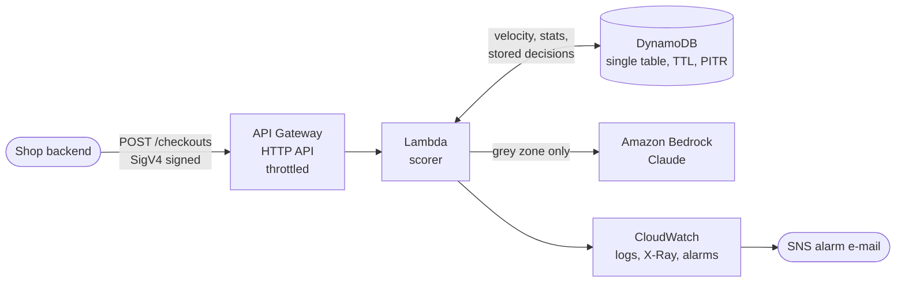
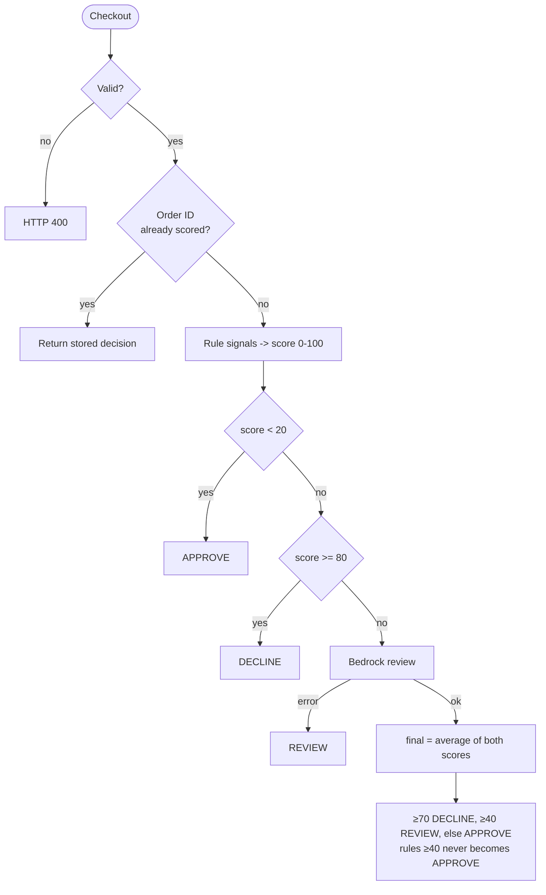

# Serverless Checkout Fraud Detector


A serverless API that scores an online checkout and returns `APPROVE`, `REVIEW` or `DECLINE`. Fast, explainable rules handle the clear cases. Amazon Bedrock (Claude) reviews only the unclear ones, so most requests cost nothing extra and the model never decides alone.

Built with Terraform, Python 3.12, API Gateway (HTTP API), Lambda, DynamoDB and Amazon Bedrock.

## Architecture





<!-- Replace with an exported diagram after you deploy:
 -->

## Demo

> **Demo video:** _placeholder. Record `scripts/send_orders.py` against a deployed stack and add the link here before you delete the AWS resources._

## API

`POST /checkouts`

```json
{
  "order_id": "ord-1001",
  "customer_id": "cus-42",
  "email": "jane@example.com",
  "amount": "59.99",
  "currency": "GBP",
  "ip_address": "203.0.113.10",
  "billing_country": "GB",
  "shipping_country": "GB",
  "card_bin": "424242",
  "card_last4": "4242",
  "account_age_days": 400,
  "item_count": 2
}
```

Response:

```json
{
  "order_id": "ord-1001",
  "decision": "REVIEW",
  "risk_score": 58,
  "rule_score": 25,
  "llm_score": 90,
  "signals": ["COUNTRY_MISMATCH", "NEW_ACCOUNT"],
  "reasons": ["billing GB, shipping NG", "account created today", "..."],
  "source": "rules+bedrock",
  "latency_ms": 0
}
```

The example values come from the unit tests. `latency_ms` is measured per request; no latency figure is claimed here.

`GET /checkouts/{order_id}` returns the stored decision. Sending the same `order_id` again returns the first decision (`"idempotent_replay": true`), so client retries are safe.

## Rule signals

| Signal | Points | When |
| --- | --- | --- |
| `COUNTRY_MISMATCH` | 15 | Billing and shipping country differ |
| `DISPOSABLE_EMAIL` | 20 | E-mail domain is on a disposable list |
| `NEW_ACCOUNT` | 10 | Account is less than 1 day old |
| `CARD_VELOCITY` | 25 | 3 or more orders on the same card (BIN + last 4) in 1 hour |
| `IP_VELOCITY` | 20 | 5 or more orders from the same IP in 1 hour |
| `CUSTOMER_VELOCITY` | 15 | 4 or more orders by the same customer in 1 hour |
| `AMOUNT_SPIKE` | 20 | Amount is more than 5 times the customer's average |
| `HIGH_FIRST_ORDER` | 15 | First order of 1,000 or more |
| `BULK_ITEMS` | 10 | 10 or more items |

The weights are starting values for a demo. They are not tuned on real fraud data. Tune them on your own labelled orders.

## Design decisions

- **Rules first, model second.** Bedrock is called only when the rule score is between 20 and 79. Clear cases skip the model, which keeps cost and latency down.
- **The model cannot approve alone.** If the rule score is 40 or more, the order is at least `REVIEW`, whatever the model says. If Bedrock fails or times out, the order goes to `REVIEW`, never `APPROVE`.
- **Data minimisation.** The model gets features only: amount, countries, e-mail domain, velocity counts and rule signals. It never gets the card digits, the customer ID or the e-mail local part. A unit test checks this.
- **Prompt injection.** Input is validated first (strict formats for IDs, countries, IPs, card fields). The features are sent as JSON inside `<checkout>` tags, and the system prompt says to treat them as data. The model answer is parsed, clamped to 0-100 and limited to 3 reasons.
- **No card numbers stored.** Velocity uses BIN + last 4 only. Velocity markers expire after 24 hours (DynamoDB TTL).
- **Single-table DynamoDB.** Decisions, velocity markers and per-customer spend stats share one on-demand table. See `src/fraud/store.py`.
- **Idempotency.** The decision is written with a conditional put (`attribute_not_exists`), so two concurrent requests for one order cannot both write.
- **Auth and abuse.** The API uses IAM auth (SigV4) by default, because the caller is a shop backend, not a browser. Stage throttling limits requests per second.

## Deploy

Requirements: Terraform 1.6 or later, AWS credentials for a test account, and Bedrock model access for the model you choose (Bedrock console, Model access).

```bash
cd terraform
cp terraform.tfvars.example terraform.tfvars
terraform init
terraform apply
```

Check that `bedrock_model_id` exists in your region. The default is a US cross-region inference profile for Claude Haiku 4.5. For rules only, set `bedrock_enabled = false`.

## Try it

```bash
pip install boto3
python scripts/send_orders.py "$(terraform -chdir=terraform output -raw api_url)"
```

Or with curl (7.75 or later):

```bash
curl --aws-sigv4 "aws:amz:us-east-1:execute-api" \
  --user "$AWS_ACCESS_KEY_ID:$AWS_SECRET_ACCESS_KEY" \
  -H "x-amz-security-token: $AWS_SESSION_TOKEN" \
  -H "Content-Type: application/json" \
  -d @tests/sample-order.json \
  "$(terraform -chdir=terraform output -raw api_url)/checkouts"
```

## Run the tests

```bash
python -m venv .venv && source .venv/bin/activate
pip install -r requirements-dev.txt
pytest --cov=fraud
```

DynamoDB is faked with moto. Bedrock is replaced by a stub, so no AWS account is needed. CI runs Ruff, pytest with a coverage gate, `terraform fmt` and `validate`, and Checkov.

## Cost

Everything is pay-per-request: API Gateway, Lambda, DynamoDB on-demand and Bedrock tokens. There is no idle cost apart from CloudWatch log storage. Bedrock is the main cost per request, and it runs only for grey-zone orders. Check current prices for your model and region on the Bedrock pricing page.

## Clean up

```bash
terraform -chdir=terraform destroy
```

## Project layout

```text
src/fraud/models.py    input validation
src/fraud/signals.py   rule signals and rule score
src/fraud/store.py     DynamoDB access (velocity, stats, idempotency)
src/fraud/llm.py       Bedrock Converse call and answer parsing
src/fraud/handler.py   API routes and decision logic
tests/                 unit tests (moto + Bedrock stub)
terraform/             API Gateway, Lambda, DynamoDB, IAM, alarms
scripts/send_orders.py send 3 sample orders to a deployed stack
```

## Licence

MIT. See [LICENSE](LICENSE).
